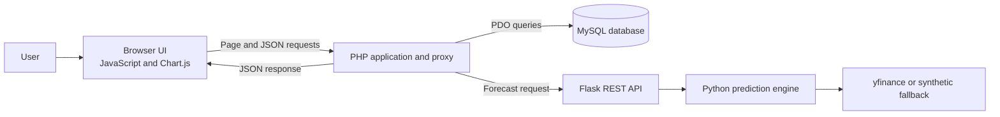
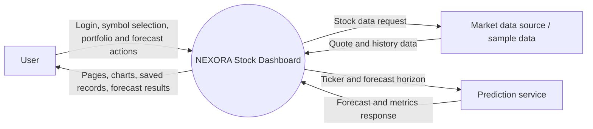
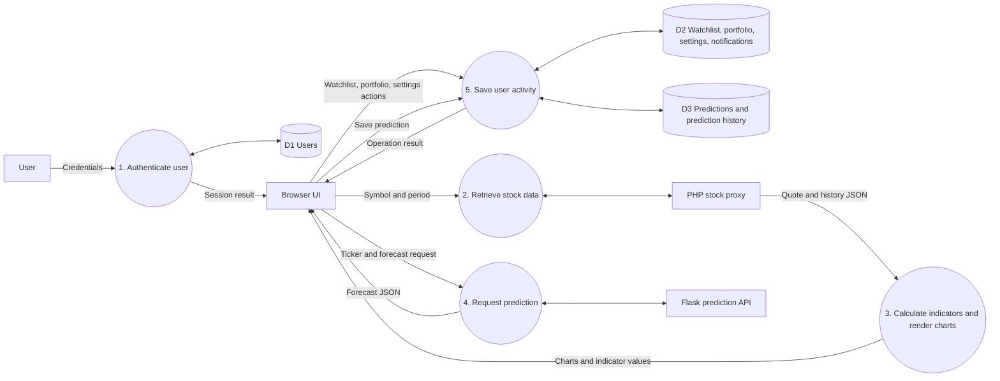
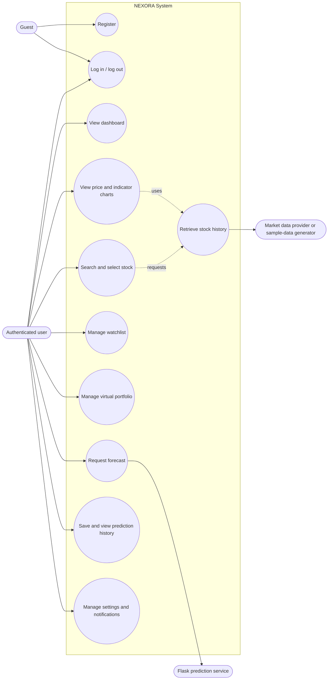
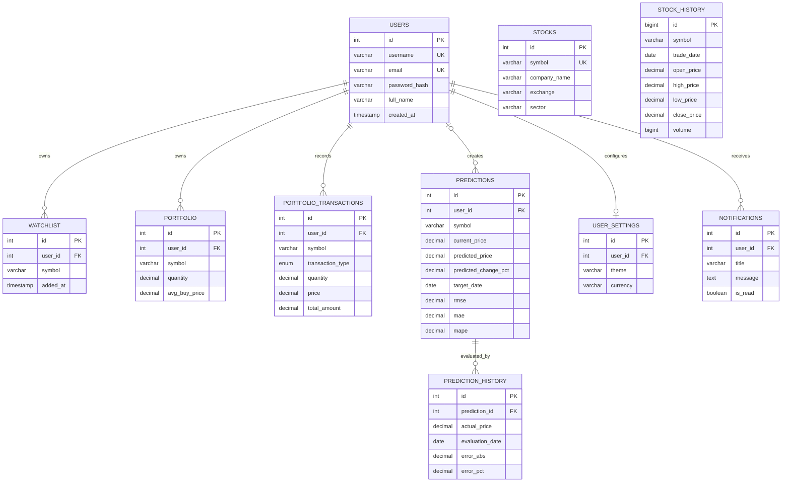

# NEXORA Project Proposal and System Design

## 1. Project Proposal

### 1.1 Introduction

NEXORA is a web-based stock analysis and prediction dashboard designed to bring stock exploration, technical charts, personal watchlists, virtual portfolio tracking, and experimental price forecasting into one application. The user interface is built with HTML, CSS, JavaScript, Bootstrap, and Chart.js. PHP handles page requests, sessions, and database operations. MySQL stores application records, while a Python Flask service exposes machine-learning prediction endpoints.

The project demonstrates how a multi-tier web application can connect a browser, server-side code, a relational database, and a separate machine-learning service. Users can select a stock symbol, view price and volume charts, inspect technical indicators, manage saved items, and review recorded prediction results.

The project is an educational prototype. In the current implementation, the PHP stock proxy generates deterministic sample quote and historical chart data. The Python prediction engine attempts to retrieve market history with `yfinance`, and generates synthetic data if retrieval is unavailable. Forecasts and fallback metrics must not be interpreted as guaranteed outcomes or financial advice.

### 1.2 Project Problem and Solution

#### Problem

Stock information is often split across separate tools, and raw price values are difficult for new users to interpret. Users may also want to retain their own watchlists, simulated holdings, and forecast history. In an integrated system, the frontend, application backend, database, and prediction service must exchange data consistently and handle user-specific records securely.

#### Proposed Solution

NEXORA provides a single web application that:

- Displays stock prices, trading volume, and technical indicators using interactive charts.
- Provides authenticated pages and stores user-specific watchlist, portfolio, settings, and prediction records.
- Uses PHP and PDO to process application requests and access MySQL through prepared statements.
- Uses a Flask REST API to expose prediction and model information endpoints.
- Returns structured JSON to the browser so chart and dashboard elements can be updated without a full page reload.

The application helps demonstrate market-data visualization and software integration. It does not execute real trades and is not intended to provide investment recommendations.

### 1.3 Technology Requirements

#### Software Requirements

| Component | Requirement / Use |
| --- | --- |
| Operating system | Windows, Linux, or macOS development environment. |
| Web browser | Current version of Chrome, Edge, Firefox, or another modern browser. |
| Web server | PHP built-in server for development, or Apache through XAMPP. |
| PHP | PHP runtime with PDO and the MySQL PDO driver enabled. |
| Database | MySQL or compatible MariaDB server. |
| Python | Python runtime compatible with packages in `python_ml/requirements.txt`. |
| Python packages | Flask, Flask-CORS, NumPy, pandas, scikit-learn, yfinance, and TensorFlow/Keras as listed by the project requirements. |
| Frontend libraries | Bootstrap and Chart.js, loaded by the project pages. |
| Development tools | Code editor, terminal, and phpMyAdmin or MySQL command-line client. |

TensorFlow is optional for the model engine: when it is unavailable, the engine uses a simpler regression fallback. Internet access is needed for package installation and for `yfinance` data retrieval. The PHP chart proxy currently generates sample data independently of `yfinance`.

#### Hardware Requirements

- A computer capable of running a PHP web server, MySQL, and Python locally.
- Recommended baseline for development: dual-core processor, 4 GB RAM, and several hundred MB of free disk space for source files and packages.
- Additional memory and processing capacity may be required to train TensorFlow models.
- A network connection is required when installing dependencies or attempting external market-data access.

## 2. System Requirements

### 2.1 System Study

#### Existing System

Users may need separate websites or applications to view charts, calculate indicators, track a watchlist, and record portfolio activity. Information kept manually is harder to update and is not automatically associated with an authenticated user. Integrating an external prediction process with a web interface also requires an API boundary.

#### Proposed System

NEXORA combines these learning and demonstration functions in one web application. PHP manages web interactions and MySQL persistence; JavaScript and Chart.js render chart data; a separate Flask service handles prediction requests. The separation allows the interface, backend, database, and prediction engine to be developed and tested as distinct components.

#### Feasibility Study

- **Technical feasibility:** The project uses widely available open-source technologies and can run locally with PHP, MySQL, and Python. TensorFlow training may require more resources than other modules.
- **Operational feasibility:** The browser interface provides direct access to dashboards, chart views, watchlists, portfolio pages, and prediction history.
- **Economic feasibility:** The prototype uses open-source software and does not require paid infrastructure to run locally. A production market-data provider may involve licensing or subscription costs.
- **Schedule feasibility:** The system is divided into modules that can be developed and tested independently, such as authentication, stock charts, persistence, and prediction integration.

#### Functional Requirements

1. The system shall allow users to register, log in, and log out.
2. The system shall restrict protected pages to authenticated users.
3. The system shall display stock information and historical chart data for a selected symbol and period.
4. The system shall calculate and display SMA, EMA, RSI, and MACD indicators.
5. The system shall allow a user to add and remove symbols from a personal watchlist.
6. The system shall allow a user to maintain virtual holdings and transaction records.
7. The system shall request a forecast from the Flask service or its configured fallback path.
8. The system shall allow forecast results to be saved and listed as prediction history.
9. The system shall store user settings and notifications.

#### Non-Functional Requirements

- **Security:** Use password hashing, session checks, parameterized database queries, and output escaping.
- **Usability:** Organize information into clear pages and use charts to make time-series data easier to inspect.
- **Maintainability:** Keep PHP, SQL schema, JavaScript, and Python service code in separate modules.
- **Performance:** Return only the data required by the selected page or action and use indexes for common database lookups.
- **Reliability:** Return structured API responses and handle unavailable Flask or data dependencies with explicit fallback/error behavior.
- **Portability:** Support common development operating systems with the required runtimes installed.

### 2.2 Modules Description

| Module | Description | Main files |
| --- | --- | --- |
| Authentication | Registration, login, logout, session creation, and access checks. | `auth/login.php`, `auth/register.php`, `auth/logout.php`, `config/config.php` |
| Dashboard | Presents overview information and shortcuts to stock features. | `dashboard.php` |
| Stock explorer | Lets users search and select stock symbols. | `explorer.php` |
| Stock detail and charts | Requests a selected symbol and period, then renders price, volume, RSI, and MACD charts. | `stock_detail.php`, `api/stock_proxy.php`, `assets/js/app.js` |
| Technical indicators | Calculates moving averages, RSI, and MACD for chart datasets. | `assets/js/app.js`, `python_ml/indicators.py` |
| Prediction service | Provides health, prediction, model information, and performance-summary routes. | `python_ml/app.py`, `python_ml/model_engine.py` |
| Prediction persistence | Saves forecast values, target dates, metrics, and model version. | `prediction.php`, `prediction_history.php` |
| Watchlist | Adds, removes, and displays user-specific stock symbols. | `watchlist.php`, `api/watchlist_action.php` |
| Virtual portfolio | Tracks simulated holdings and buy/sell transactions. | `portfolio.php`, `api/portfolio_action.php` |
| User preferences | Saves and updates theme and other preferences. | `settings.php`, `api/theme_toggle.php` |
| Notifications | Displays user-specific messages and supports marking them read. | `notifications.php`, `api/notification_action.php` |
| Database | Defines tables, constraints, seed data, and relationships. | `database/schema.sql` |

### 2.3 Vision Document

#### Vision Statement

To provide an accessible educational dashboard that brings stock-data visualization, personal tracking, and experimental forecasting together in a modular web application.

#### Target Users

- Students learning full-stack application development or financial-data visualization.
- Users who want to explore stock charts and technical indicators in a single interface.
- Developers demonstrating integration among PHP, MySQL, Python, REST APIs, and browser charting.

#### User Needs

- Quickly select a stock and inspect its historical price movement.
- Understand trading volume and common technical indicators through graphs.
- Retain a personal watchlist and simulated portfolio.
- Save forecast results for later viewing.
- Receive clear feedback if an API, database, or prediction dependency is unavailable.

#### Product Scope and Success Criteria

The prototype is successful when a user can navigate the main application, view chart data, use the personal tracking modules, request and save a prediction, and retrieve that user's records from MySQL. For production readiness, success would additionally require verified market data, rigorous time-based model evaluation, stronger deployment security, and operational monitoring. Those production properties are outside the guarantees of the current prototype.

## 3. System Design

### 3.1 Architectural Design

NEXORA follows a layered architecture:

1. **Presentation layer:** HTML, CSS, JavaScript, Bootstrap, and Chart.js run in the browser.
2. **Application layer:** PHP renders pages, checks sessions, validates requests, returns JSON, and coordinates external service calls.
3. **Persistence layer:** MySQL stores users and application records. PHP accesses it through PDO.
4. **Prediction layer:** Flask exposes REST endpoints and invokes the Python model engine.
5. **Data input:** The Python model attempts `yfinance` retrieval and has a synthetic-data fallback. The PHP chart proxy currently generates deterministic sample history.

### 3.2 DFD Diagram

#### Level 0: Context Diagram

The market data source represents the data provider boundary. In the current PHP chart path, the returned chart history is generated sample data. The Python forecast path may attempt `yfinance` retrieval and can fall back to synthetic data.

#### Level 1: Main Processes and Data Stores

### 3.3 Use-Case Diagram

### 3.4 ER Diagram

The diagram below focuses on the implemented foreign-key relationships and the central user-owned records. `stock_history` and several stock-symbol columns do not currently have foreign keys to `stocks`, so no relationship is drawn for them.

## 4. Software Testing

The following are proposed test cases for validating the current implementation. They are test plans and expected results, not a statement that all tests have already been executed.

### 4.1 Integration Testing

Integration testing verifies that connected modules exchange data correctly.

| Test ID | Integrated components | Test procedure | Expected result |
| --- | --- | --- | --- |
| IT-01 | Browser, PHP stock proxy, Chart.js | Open stock detail, select a symbol and period. | The proxy returns JSON and the browser renders price and volume graphs from its history array. |
| IT-02 | Browser, indicator utility, Chart.js | Load enough observations to calculate SMA, EMA, RSI, and MACD. | Indicator arrays align with the date labels and supported charts render without a full-page reload. |
| IT-03 | PHP proxy and Flask API | Start Flask and request a prediction through the PHP proxy. | PHP forwards the ticker request and returns the Flask JSON response. |
| IT-04 | PHP proxy and fallback prediction path | Stop Flask and request a prediction. | The configured fallback response is returned; it is recognized as fallback/demo output. |
| IT-05 | PHP/PDO and MySQL | Save a prediction through the prediction page. | A prediction record is inserted and a linked prediction-history record is created. |
| IT-06 | Authentication, session, and user-owned tables | Log in and add a watchlist item, then query the watchlist. | The item is associated with the logged-in user and appears only in that user's list. |
| IT-07 | Portfolio action and MySQL | Perform a virtual buy or sell action. | The holding and transaction records reflect the accepted operation. |

### 4.2 System Testing

System testing validates end-to-end user workflows across the whole application.

| Test ID | Scenario | Test procedure | Expected result |
| --- | --- | --- | --- |
| ST-01 | New account | Register with valid unique details and then log in. | The account is created and valid credentials establish a session. |
| ST-02 | Invalid login | Attempt login with an incorrect password. | Access is denied and no authenticated session is created. |
| ST-03 | Protected page | Open a protected page in a logged-out browser. | The application redirects to the login page. |
| ST-04 | Stock analysis | Select a supported symbol and switch chart periods. | The displayed quote fields and charts update using the returned data. |
| ST-05 | Watchlist workflow | Add a symbol, refresh the page, then remove it. | The saved item persists between requests and is removed after the action. |
| ST-06 | Virtual portfolio workflow | Submit an allowed simulated transaction and open the portfolio page. | The portfolio page shows the updated holding and transaction history. |
| ST-07 | Prediction workflow | Request a forecast, save it, and open prediction history. | The forecast response is displayed and the saved record can be retrieved. |
| ST-08 | Service unavailable | Stop MySQL or Flask in a controlled test environment and load the related feature. | The application handles the failure without exposing credentials or an unhandled stack trace. |

### 4.3 Unit Testing

Unit testing validates a small function or component independently, using controlled inputs.

| Test ID | Unit under test | Example input | Expected result |
| --- | --- | --- | --- |
| UT-01 | SMA calculator | Prices `[10, 20, 30]`, period `2` | Values are `[null, 15, 25]` according to the frontend calculator's warm-up behavior. |
| UT-02 | EMA calculator | A known numeric series and a short period | First full-window value is the initial mean; subsequent values follow the EMA recurrence. |
| UT-03 | RSI calculator | Monotonically rising prices | RSI approaches 100; output values remain on the 0–100 scale. |
| UT-04 | MACD calculator | A known price series | MACD, signal, and histogram arrays have the same length as the input series. |
| UT-05 | Symbol normalization | Input `" aapl "` | Normalized symbol is `AAPL`. |
| UT-06 | Forecast request parsing | Missing or non-integer `days` parameter | The Flask endpoint uses its default horizon of 7 days. |
| UT-07 | Database uniqueness | Insert the same `(user_id, symbol)` watchlist pair twice | The second duplicate is rejected by the unique constraint. |
| UT-08 | Prepared-query behavior | Query with a symbol containing quote characters | The value is treated as a bound parameter, not executable SQL. |

For repeatable testing, indicator functions should be tested with fixed arrays, database tests should use a dedicated test database, and API tests should use controlled responses rather than depend on external market-data availability.
